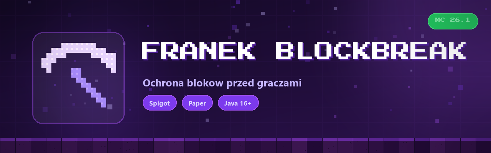

# FranekBlockBreak



Blokada niszczenia blokow dla graczy bez op. Dziala troche na odwrot niz wiekszosc
tego typu pluginow - lista w configie to bloki ktore MOZNA kopac, a nie ktore sa
zablokowane. Wszystko czego nie ma na liscie, gracz bez op nie ruszy.

Domyślnie na liscie sa tylko blok diamentow i ruda diamentow, wiec gracz bez op
moze kopic wlasnie to, a reszta jest chroniona. Adminowie (`op`) kopia wszystko.

## Config

`plugins/FranekBlockBreak/config.json`, tworzy sie sam:

```json
{
  "options": {
    "breakableBlocks": [
      "DIAMOND_BLOCK",
      "DIAMOND_ORE"
    ]
  }
}
```

Wpisujesz nazwy blokow z listy
[`Material`](https://hub.spigotmc.org/javadocs/bukkit/org/bukkit/Material.html).
Po zmianach restart serwera.

## Instalacja

Jar z folderu [`releases/`](releases/) wrzucasz do `plugins/` na kazdym serwerze
gry (Spigot / Paper) i restart.

## Budowanie

```bash
mvn package
```

Wychodzi `target/FranekBlockBreak-1.0.jar`. Wymaga JDK 16+ i Mavena.

## Licencja

Wszelkie prawa zastrzeżone. Autor: franek_ ([GitHub](https://github.com/Blejziak)).
